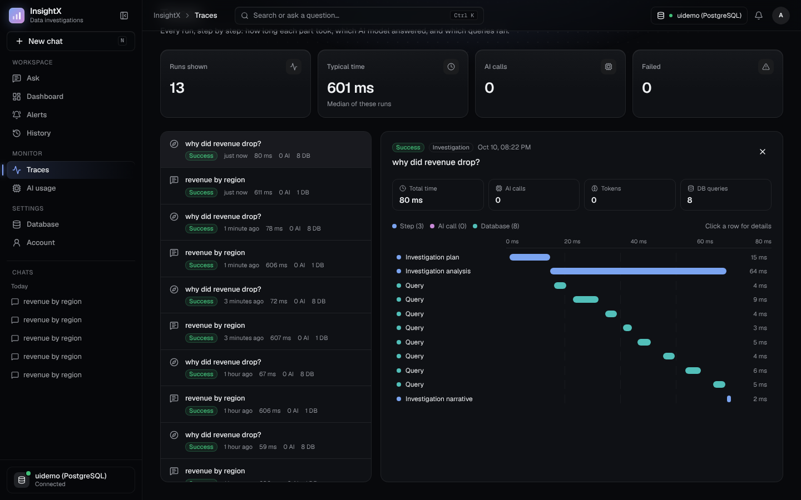
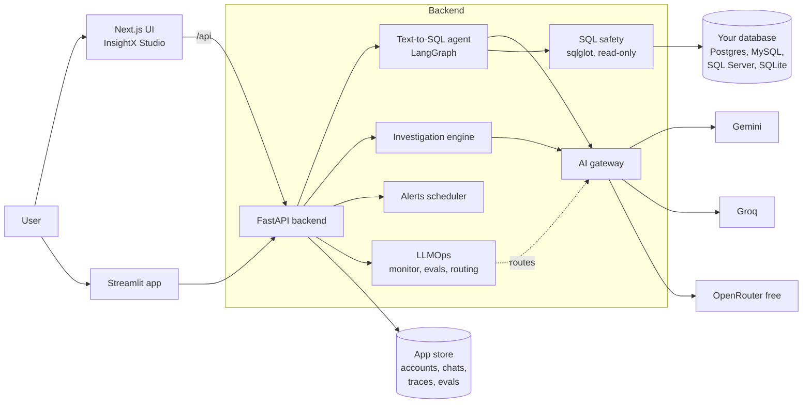
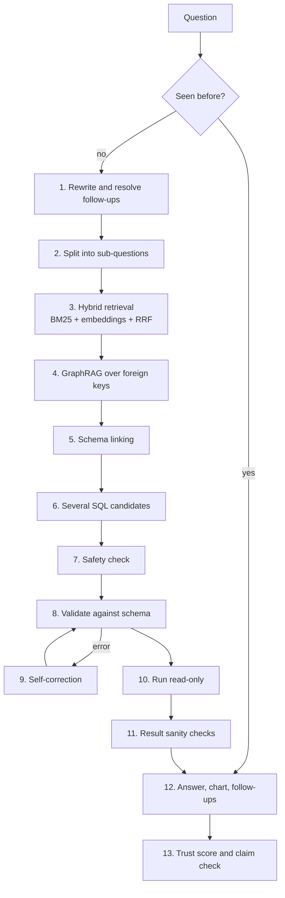

<div align="center">

# InsightX

**Ask your database a question in plain English. Get the SQL, the answer, a chart, and proof the answer is true.**

An AI data analyst that turns questions into safe, read-only SQL, checks its own answers for hallucinations, explains *why* a number changed, and measures itself with an evaluation and LLMOps layer. It runs on free LLMs only.


-8A2BE2)

[Features](#features) · [How it works](#how-it-works) · [Accuracy](#accuracy) · [LLMOps](#llmops-measuring-the-ai) · [Quick start](#quick-start) · [Tech stack](#tech-stack)


</div>

---

## Why InsightX

Most Text-to-SQL demos stop at "the model wrote some SQL". In real work that is not enough:

- **Is the answer true?** LLMs confidently state numbers that are not in the data.
- **Is the SQL safe?** A wrong query must never change or delete data.
- **Why did it change?** People don't just want "revenue fell 8%", they want the reason.
- **Is it getting better or worse?** Without evaluation you can't tell if a prompt or model change broke something.

InsightX is built around those four questions.

## Features

| | Feature | What it does |
|---|---|---|
| **Ask** | Text-to-SQL agent | A 13-step LangGraph pipeline: rewrites the question, finds the right tables with hybrid search and GraphRAG, writes several SQL candidates, checks and fixes them, runs the best one. |
| | Trust score | Every answer gets a 0 to 100 trust score. Numbers and names in the answer are checked against the real result rows. |
| | Auto charts | Picks a chart type that fits the result (bar, line, pie, table). |
| | Ask next | Suggests follow-up questions you can click. |
| **Investigate** | "Why did X change?" | Compares periods, breaks the change down by every dimension, checks seasonality and last year, and writes the **real reason** with evidence. |
| **Safety** | Read-only by design | SQL is parsed with `sqlglot`; anything that is not a single `SELECT` is blocked. Queries run in read-only transactions with timeouts and row limits. |
| **Dashboard** | Whole-database overview | Table sizes and automatic charts with no AI calls. Type "sales by month as a line" to add your own chart. |
| **Alerts** | Smart anomaly alerts | Robust trend + weekday/seasonal habits + MAD spread. Back-tests an alert before you save it. Slack, Discord, Teams or email. |
| **Pipeline** | See every step | Watch each of the 13 stages run, with timings, tables found and SQL written. |
| **Traces** | Waterfall timeline | Every run is traced: steps, AI calls, tokens and database queries. |
| **LLMOps** | Monitor, Evals, Hallucination, Quality, Smart routing | Live SLOs and error budgets, a golden-set evaluation harness with a quality gate, hallucination checks with an optional AI judge, a feedback loop that turns fixes into tests, and a router that picks the best free model per question. |
| **Platform** | Accounts and history | Sign-up and login, private chats, connections and history per account, per-user daily limits. |
| | Many databases | PostgreSQL, MySQL/MariaDB, SQL Server, SQLite, and CSV/Excel upload (loaded fast with DuckDB). |

## Screenshots

<table>
<tr>
<td width="50%"><b>Investigation: the real reason behind a change</b><br></td>
<td width="50%"><b>Pipeline: every step behind an answer</b><br></td>
</tr>
<tr>
<td width="50%"><b>Hallucination check on a single answer</b><br></td>
<td width="50%"><b>Traces: waterfall of one run</b><br></td>
</tr>
</table>

**Evals: a report with its quality gate**


## How it works

### Architecture



### The question pipeline



### The AI gateway

All model calls go through one gateway, so the rest of the code never talks to a provider directly.

- **Tiers:** `light` (rewriting, follow-ups), `sql` (SQL writing), `heavy` (repairs and investigations). Each tier has an ordered list of free models.
- **Failover:** if a model errors or hits its limit, the next one is tried, then the next tier.
- **Free-limit aware:** tracks per-minute and daily limits, and puts a model on cooldown when its quota runs out.
- **Usage ledger:** every call is logged with model, tokens, time and user, which feeds the Monitor and AI usage pages.

## Accuracy

Measured with the built-in evaluation harness (`python -m backend.evaluation`) on golden question sets with known-correct SQL. A question counts as correct when the result rows match.

<picture>
  <source media="(prefers-color-scheme: dark)" srcset="docs/images/benchmark-dark.svg">
  
</picture>

| Dataset | Tables | Questions | Execution accuracy | Unanswerable questions declined | Destructive requests blocked | Answer faithfulness |
|---|---|---|---|---|---|---|
| Warehouse (AdventureWorks, Pagila, Northwind, Chinook in one database) | 108 | 27 | **92.6%** (95% CI 76.6 to 97.9) | 100% | 100% | 100% |
| Olist e-commerce | 9 | 49 | **75.5%** (95% CI 61.9 to 85.4) | 100% | 100% | 100% |

All runs used free models only. The weak spots are honest and visible: nested queries, ratios and `HAVING` on Olist. The Evals page tracks these by tag so improvements and regressions show up run by run.

## LLMOps: measuring the AI

Five pages in the **LLMOps** section of the sidebar.

- **Monitor:** questions, success rate, p50/p95 answer time, model errors, hallucination rate, cache hits and tokens. SLOs with an error budget, and automatic incident detection (median + 3 MAD).
- **Evals:** run golden sets from the UI, compare two runs (regressions and fixes), and set a **quality gate** (minimum accuracy, faithfulness, safety, maximum latency).
- **Hallucination:** every answer is checked without extra AI calls: numbers and names not in the result, claims about empty results, wrong "top N", wrong highest/lowest, wrong row counts and join fan-out. An optional AI judge can review one answer on demand.
- **Quality:** rate answers, review weak ones, fix the SQL, test it, then **promote it to a golden test** so it can never silently break again.
- **Smart routing:** scores each free model by measured accuracy, success rate, speed and free quota left, weighted by question difficulty. Modes: off, shadow (log only) and on.

## Quick start

### 1. Requirements

- Python 3.11+
- Node.js 20+ (for the new UI)
- A database to ask questions about (PostgreSQL, MySQL, SQL Server or SQLite), or just upload CSV/Excel files
- At least one **free** AI key: [Google Gemini](https://aistudio.google.com/apikey), [Groq](https://console.groq.com/keys) or [OpenRouter](https://openrouter.ai/keys)

### 2. Get the code and set your keys

```bash
git clone https://github.com/anchalrajput25/InsightX.git
cd InsightX
cp .env.example .env        # on Windows: copy .env.example .env
```

Open `.env` and paste your own key(s). Your `.env` is ignored by git and never uploaded.

### 3. Start the backend

```bash
python -m venv .venv
# Windows: .venv\Scripts\activate      macOS/Linux: source .venv/bin/activate
pip install -r requirements.txt
uvicorn backend.main:app --reload --port 8000
```

API docs are at http://localhost:8000/docs.

### 4. Start the UI

```bash
cd insightx-ui
npm install
npm run dev
```

Open http://localhost:3000, create an account, connect a database and ask a question.

> There is also the original Streamlit app: `streamlit run app.py`.

### Docker

```bash
docker compose up --build
```

Starts the app and a PostgreSQL database for InsightX's own data. See [DEPLOY.md](DEPLOY.md) to put it online for free.

## Configuration

| Variable | Needed | What it is |
|---|---|---|
| `GEMINI_API_KEY`, `GROQ_API_KEY`, `OPENROUTER_API_KEY` | at least one | Free AI keys |
| `INSIGHTX_AUTH_SECRET` | online | Long random text that signs logins and encrypts saved database passwords |
| `INSIGHTX_APP_DB_URL` | online | PostgreSQL URL for accounts, chats, traces and evals (local files are used if empty) |
| `INSIGHTX_USER_DAILY_QUESTIONS` | optional | Questions per user per day (default 100) |
| `INSIGHTX_AUTH_REQUIRED` | optional | `0` turns sign-in off on your own PC |

## Tech stack

| Layer | Tools |
|---|---|
| Agent | LangGraph, LangChain Core, LiteLLM |
| Retrieval | BM25, `all-MiniLM-L6-v2` embeddings, Reciprocal Rank Fusion, GraphRAG over foreign keys |
| SQL | SQLAlchemy, sqlglot (parsing, safety and dialects), DuckDB (fast file loading) |
| Backend | FastAPI, Pydantic, Uvicorn |
| Frontend | Next.js 15, React 19, Tailwind CSS 4, shadcn/ui, Recharts, TanStack Query |
| Data | PostgreSQL, MySQL/MariaDB, SQL Server, SQLite |
| Quality | pytest (390+ tests), golden-set evaluation harness, tracing |
| Deploy | Docker, Docker Compose |

## Project structure

```
backend/
  text_to_sql/     LangGraph agent: rewrite, retrieval, GraphRAG, SQL generation, safety, correction, trust
  investigation/   "Why did it change?" engine
  ai_gateway/      Free-model gateway: tiers, failover, limits, usage ledger
  llmops/          Monitor, evals, hallucination checks, feedback, smart routing
  alerting/        Anomaly detection and notifications
  evaluation/      Benchmark harness and golden sets
  auth/            Accounts, passwords, tokens
  tests/           pytest suite
insightx-ui/       Next.js UI (InsightX Studio)
app.py             Streamlit app
```

## Run the tests

```bash
pytest
```

## Roadmap

- [ ] Live demo link
- [ ] Bring-your-own API key per account
- [ ] Spider / BIRD benchmark subset
- [ ] CI with GitHub Actions
